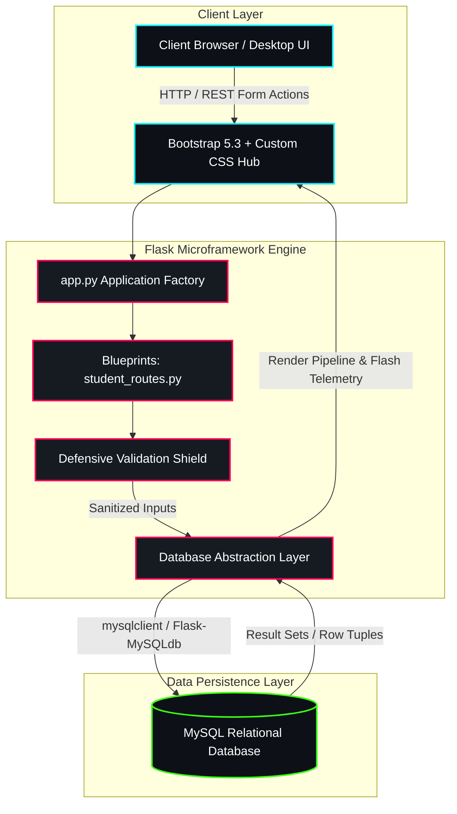

<div align="center">

```
  ███████╗████████╗██╗   ██╗██████╗ ███████╗███╗   ██╗████████╗    ██╗  ██╗██╗   ██╗██████╗ 
  ██╔════╝╚══██╔══╝██║   ██║██╔══██╗██╔════╝████╗  ██║╚══██╔══╝    ██║  ██║██║   ██║██╔══██╗
  ███████╗   ██║   ██║   ██║██║  ██║█████╗  ██╔██╗ ██║   ██║       ███████║██║   ██║██████╔╝
  ╚════██║   ██║   ██║   ██║██║  ██║██╔══╝  ██║╚██╗██║   ██║       ██╔══██║██║   ██║██╔══██╗
  ███████║   ██║   ╚██████╔╝██████╔╝███████╗██║ ╚████║   ██║       ██║  ██║╚██████╔╝██████╔╝
  ╚══════╝   ╚═╝    ╚═════╝ ╚═════╝ ╚══════╝╚═╝  ╚═══╝   ╚═╝       ╚═╝  ╚═╝ ╚═════╝ ╚═════╝ 
```

### ⚡ NEXT-GEN STUDENT RECORD TELEMETRY & MANAGEMENT SYSTEM ⚡

[](https://python.org)
[](https://flask.palletsprojects.com/)
[](https://mysql.com/)
[](https://getbootstrap.com/)
[](#system-architecture)
[](https://github.com/datttux/StudentManagemnet_Flask_App)

<p align="center">
  <b>A high-velocity, scalable, cyber-styled Student Information Management Platform engineered with Flask Application Factory architecture, robust MySQL relational persistence, parameterized defensive security, and a real-time reactive telemetry dashboard.</b>
</p>

---

</div>

## 🌌 Overview

**StudentHub** is an industrial-grade academic record management console designed to replace outdated record-keeping with a lightning-fast, reactive, and visually arresting data operations hub. Built upon Python's **Flask** microframework and connected to an enterprise **MySQL** relational engine, it delivers high-integrity CRUD (Create, Read, Update, Delete) telemetry, instantaneous multi-parameter filtering, and automated input validation shields.

---

## ⚡ System Architecture

The project adopts a decoupled **Modular Blueprint Architecture**, isolating extension initialization from application routing to ensure zero circular dependencies and maximum maintainability:



---

## 🚀 Key Modules & Capabilities

### 🛡️ Defensive Input Validation Shield
- **Regex Format Enforcement**: Strict RFC-compliant email verification pattern `^[a-zA-Z0-9_.+-]+@[a-zA-Z0-9-]+\.[a-zA-Z0-9-.]+$`.
- **E.164 Phone Sanitization**: Cleans and validates domestic and international dialing sequences (10–15 digits) while stripping formatting artifacts.
- **Payload Bound Checks**: Guards against memory overflow and truncation via boundary checks on all student attribute strings.
- **Duplicate Collision Detection**: Pre-execution verification queries intercept duplicate student email registrations prior to database commit.

### 🔄 Full-Cycle CRUD Telemetry
- **Create**: Dynamic modal-based onboarding with instantaneous server-side feedback.
- **Read**: High-density data matrix featuring live counters, department badges, and cohort indicators.
- **Update**: Non-destructive live record manipulation with pre-populated input hydration.
- **Delete**: Dual-layer fail-safe confirmation modals with immediate transactional cleanup.

### 🔍 Real-Time Multi-Parameter Search Engine
- Multi-vector keyword filtering across **Name**, **Email**, and **Phone Number**.
- Segment-level isolation by **Department**, **Academic Course**, and **Cohort Admission Year**.
- Dual-direction sorting protocols (**Chronological / Primary Key ID** or **Alphabetical Name** ordering).

### 💎 Cyber-Glassmorphism UI / UX
- Sleek dark and gradient-accented interface crafted with responsive CSS Grid and Flexbox.
- Dynamic statistical HUD tracking total students, verified records, and system load.
- Toast-style dismissible alert streams for system feedback and transactional confirmations.

---

## 🗄️ Database Blueprint & Schema

Target Database: `student_management_db`  
Primary Entity: `students`

```sql
CREATE DATABASE IF NOT EXISTS student_management_db;
USE student_management_db;

CREATE TABLE IF NOT EXISTS students (
    id INT AUTO_INCREMENT PRIMARY KEY,
    name VARCHAR(100) NOT NULL,
    email VARCHAR(150) NOT NULL UNIQUE,
    phone VARCHAR(20) NOT NULL,
    department VARCHAR(100) DEFAULT 'Computer Science',
    course VARCHAR(100) DEFAULT 'B.Tech',
    admission_year INT DEFAULT 2024,
    created_at TIMESTAMP DEFAULT CURRENT_TIMESTAMP
) ENGINE=InnoDB DEFAULT CHARSET=utf8mb4 COLLATE=utf8mb4_unicode_ci;
```

### Field Telemetry Matrix

| Field Name | Type | Key | Nullable | Default | Description |
| :--- | :--- | :---: | :---: | :--- | :--- |
| `id` | `INT` | **PK** | No | `AUTO_INCREMENT` | Unique system record identifier |
| `name` | `VARCHAR(100)` | - | No | None | Full legal student identifier |
| `email` | `VARCHAR(150)` | **UNI** | No | None | Unique electronic communication handle |
| `phone` | `VARCHAR(20)` | - | No | None | Cleaned telecommunication string |
| `department` | `VARCHAR(100)` | - | Yes | `'Computer Science'` | Academic operational faculty division |
| `course` | `VARCHAR(100)` | - | Yes | `'B.Tech'` | Enrolled academic curriculum program |
| `admission_year` | `INT` | - | Yes | `2024` | Cohort matriculation solar year |
| `created_at` | `TIMESTAMP` | - | Yes | `CURRENT_TIMESTAMP` | Ingestion chronometer timestamp |

---

## 📡 API & HTTP Route Manifest

| Endpoint | Method | Parameter Payload | Action / Controller Logic | Return Signature |
| :--- | :---: | :--- | :--- | :--- |
| `/` | `GET` | `search`, `department`, `course`, `year`, `sort` | Fetches filtered student array & computes aggregate telemetry | `200 OK (Render index.html)` |
| `/add` | `POST` | `name`, `email`, `phone`, `department`, `course`, `admission_year` | Validates data, tests uniqueness, inserts new student record | `302 Found -> /` |
| `/edit/<id>` | `POST` | `id`, `name`, `email`, `phone`, `department`, `course`, `admission_year` | Verifies existence, collision checks email, commits updates | `302 Found -> /` |
| `/delete/<id>` | `POST` / `GET` | `id` | Confirms ID presence and deletes student record from database | `302 Found -> /` |

---

## 📂 Project Directory Topology

```
StudentManagemnet_Flask_App/
│
├── ⚙️ config.py                 # Environment-aware connection & security configurations
├── 🚀 app.py                    # Core Flask application factory & port listener
├── 📦 extensions/
│   └── __init__.py              # Centralized MySQL extension instantiation
│
├── 🚦 routes/
│   └── student_routes.py        # Controller endpoints, validation shields & SQL queries
│
├── 🎨 Templates/
│   └── index.html               # Semantic HTML5 dashboard with dynamic modal dialogs
│
├── 💅 static/
│   └── css/
│       └── style.css            # Cyberpunk / glassmorphism styling, layout & animations
│
├── 📜 CHANGES_EXPLAINED.txt     # Deep-dive architectural comparison & evolution notes
├── 📋 requirements.txt          # Python dependencies manifest
├── 🛡️ .gitignore                # Exclusion rules for virtual environments & caches
└── 📖 README.md                 # System documentation & technical guide
```

---

## 🛠️ Quickstart & Deployment Protocol

### 1. Clone the Matrix
```bash
git clone https://github.com/datttux/StudentManagemnet_Flask_App.git
cd StudentManagemnet_Flask_App
```

### 2. Initialize Virtual Environment
```bash
# On macOS / Linux
python3 -m venv venv
source venv/bin/activate

# On Windows
python -m venv venv
venv\Scripts\activate
```

### 3. Install Core Dependencies
```bash
pip install -r requirements.txt
```

### 4. Configure MySQL Database
Access your MySQL CLI or workbench and deploy the schema:
```sql
CREATE DATABASE student_management_db;
```

Update your connection credentials via environment variables or inside [config.py](file:///Users/dattathreyachari/Desktop/calibo%20python%20class/Data%20Engineering/StudentManagemnet_Flask_App/config.py):
```bash
export MYSQL_HOST="localhost"
export MYSQL_USER="root"
export MYSQL_PASSWORD="your_secure_password"
export SECRET_KEY="your-cryptographic-secret"
```

### 5. Launch Application Server
```bash
python app.py
```
*Console output indicates listener status:*
```
 * Serving Flask app 'app'
 * Debug mode: on
 * Running on http://127.0.0.1:5000
```
Open **`http://localhost:5000`** in any modern web browser to access the live dashboard.

---

## 🔒 Security & Defense Protocols

- **SQL Injection Immunization**: All database interactions utilize strict parameter substitution tuples `cur.execute(query, tuple)` ensuring zero arbitrary query string interpolation.
- **Automatic Transaction Rollbacks**: Enclosed within `try...except...finally` blocks with explicit `mysql.connection.rollback()` execution on unexpected exceptions.
- **Resource Leak Prevention**: Guaranteed cursor termination (`cur.close()`) inside `finally` blocks under all execution conditions.
- **Session Protection**: Guarded by configurable `SECRET_KEY` tokens for CSRF protection and flash message tamper resistance.

---

## 🗺️ Roadmap & Future Horizons

- [x] Full CRUD operations with modal UI
- [x] Multi-parameter live search & column ordering
- [x] Defensive validation and duplicate detection
- [ ] **Role-Based Access Control (RBAC)** (Admin, Faculty, Student roles)
- [ ] **CSV / Excel Telemetry Exporter** for administrative reporting
- [ ] **RESTful JSON API v2** with JWT token-based authentication
- [ ] **Docker & Kubernetes containerization manifests**

---

## 👨‍💻 Developer & Maintainer


- **Repository**: [StudentManagemnet_Flask_App](https://github.com/datttux/StudentManagemnet_Flask_App)
- **Class**: Calibo Python Data Engineering Cohort

<div align="center">
  <sub>Engineered with precision. Powered by Python, Flask & MySQL.</sub>
</div>
